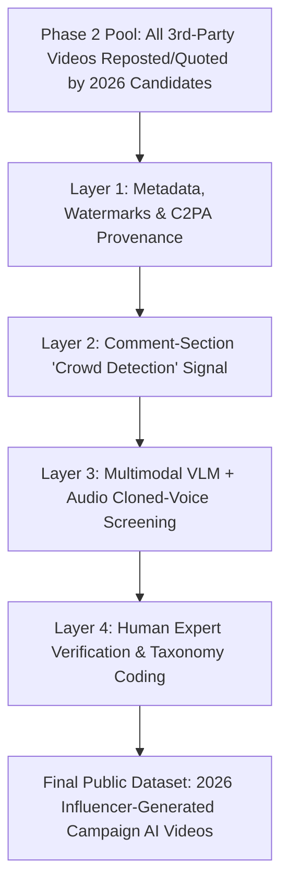

# Data Collection Plan: Strategy 2 — "Candidate Repost & Amplification" Harvesting
**Project:** Deepfake AI's Impact on Political Campaigns (2026 U.S. Elections)  
**Target Phenomenon:** Partisan social media influencers and creator collectives producing generative AI videos ("surrogate AI ads" / "slopaganda") amplified by 2026 political candidates.

---

## 1. Theoretical & Methodological Rationale: "Surrogate AI Laundering"
When official campaigns or Super PACs produce and pay to distribute a generative AI video ad, they trigger:
1. Federal FEC *"Paid for by"* disclaimer rules,
2. Google/Meta Political Ad Library archiving and mandatory *"Altered/Synthetic Content"* checkboxes, and
3. State statutory AI disclosure laws across 28+ states.

To bypass these legal and reputational costs, 2026 campaigns increasingly rely on **"Surrogate AI Laundering"**: partisan influencers, meme teams (e.g., *Dilley Meme Team*, independent TikTok/Reels/Shorts/X creators), or dark-money-funded creator networks generate synthetic attack or hype videos organically. The candidate, campaign manager, or state party account then **reposts, quote-posts, duets/stitches, or shares to Stories** the influencer's video—gaining all the persuasive or attack value while maintaining **plausible deniability** (*"We didn't make the ad; we just shared a funny meme from a supporter"*).

By anchoring data collection on **Candidate Reposts & Amplifications (Strategy 2)** rather than searching the entire internet for unlabeled AI videos:
* **The sampling frame is finite and scientifically rigorous** (anchored on a defined panel of 2026 federal/state candidates).
* **Electoral relevance is 100% guaranteed** (every captured video was explicitly elevated into a campaign's communication stream).
* **You measure both sides of the ecosystem**: the **Candidate Amplifier** (demand side) and the **Influencer Producer Network** (supply side).

---

## 2. Phase 1: Constructing the 2026 Candidate & Campaign Seed Panel
Rather than tracking every minor primary contender, construct a stratified, high-signal panel of **~250–300 candidate ecosystems** for the 2026 cycle:

1. **Tier A — All 35 U.S. Senate Races (`~70–75` Major-Party & Competitive Independent Nominees):**
   * Uses the exact roster from the 2026 U.S. Senate Election dataset (e.g., *TX: Cornyn/Paxton/Talarico; GA: Ossoff; MI: Rogers/El-Sayed; NC: Cooper/Whatley; ME: Collins/Platner; OH: Husted/Brown; AK: Sullivan/Peltola*, etc.).
2. **Tier B — Competitive U.S. House Battlegrounds (`~80` Toss-Up / Lean Districts, `~160` Nominees):**
   * Cook Political Report / Inside Elections "Toss-Up" and "Lean D / Lean R" House districts.
3. **Tier C — High-Profile Gubernatorial & State Party Accounts (`~36` Governor Races + State GOP/Dem Accounts):**
   * Official state party accounts (e.g., `@TexasGOP`, `@FlaDems`, `@AZGOP`) and campaign war-room accounts (`@Team[Candidate]`, campaign managers), which frequently act as the designated "meme reposters" when the candidate's personal account stays above the fray.

### Seed Panel Metadata Schema (`candidate_seed_panel_2026.csv`)
For each candidate ecosystem, record 3 account types across **X (Twitter), TikTok, Instagram Reels, YouTube Shorts, Truth Social, and Bluesky**:
* `candidate_personal_handle`
* `official_campaign_handle`
* `war_room_or_party_surrogate_handle`

---

## 3. Phase 2: Automated Harvesting of "Third-Party Video Amplifications"
Instead of downloading every standard stump-speech clip a candidate uploads, the harvester filters each seed account's timeline strictly for **cross-account video amplifications** (`original_video_author != seed_candidate_account`):

| Platform | Amplification Mechanisms to Capture | Collection Method / Tooling |
| :--- | :--- | :--- |
| **X (Twitter)** | • Native Retweets (`RT @influencer`) containing video • Quote-Tweets of a third-party video post • Replies by the candidate under an influencer's video (*"😂🔥"*, *"Spot on!"*) | • Apify Twitter/X Scraper or Nitter/syndication JSON feeds for the ~300 seed handles (`filter:videos include:nativeretweets`) • Media download via `yt-dlp` |
| **TikTok** | • **Reposts** tab on the candidate's profile (TikTok exposes a dedicated public `Reposts` tab showing videos the user amplified) • **Stitches** and **Duets** where the candidate reacts to an influencer's video | • `yt-dlp` / TikTok profile scraper targeting the candidate's `/reposts` feed and stitched video metadata (`stitch_info`) |
| **Instagram** | • **Collab Reels** (`@candidate and @influencer`) • Reels where the candidate's account is tagged or comments in the top thread • Campaign "Meme Roundups" (carousels embedding influencer watermarked videos) | • Instaloader / Apify Instagram Reel scraper on seed handles |
| **YouTube Shorts** | • Shorts Remixes / Collabs • Community Tab shared videos • Playlist inclusions on official campaign channels | • YouTube `youtubei/v1/browse` & `youtube_transcript_api` |
| **Truth Social** | • "ReTruths" of meme-team videos (high volume for GOP candidates amplifying groups like *Dilley Meme Team*) | • Stanford Internet Observatory / TruthBrush open-source scraper on candidate handles |

**Output of Phase 2:** A raw corpus of **Third-Party Videos Amplified by 2026 Candidates** (`candidate_amplified_videos_raw.csv`), typically numbering **2,000–5,000 videos** across a 6-month campaign window—small enough to inspect thoroughly with automated AI detection!

---

## 4. Phase 3: The 4-Layer "Is It Generative AI?" Classification Funnel
Because influencer videos rarely carry statutory state AI disclaimers, pass every candidate-amplified third-party video through a **4-layer detection funnel** to separate **conventional video edits/clips** from **Generative AI / Synthetic Media**:

### Layer 1: Metadata, Platform Labels & Visual Watermark OCR (Automated)
Check the video file and page JSON for explicit generator footprints:
* **Platform Badges:** TikTok `aigc_info` / `"Creator labeled as AI-generated"` flag; YouTube `"Altered or synthetic content"` description metadata; Meta `"AI Info"` flag.
* **C2PA / Content Credentials:** Inspect MP4/MOV container atoms using `c2patool` for OpenAI, Adobe, Microsoft, or Leica/camera provenance signatures.
* **Corner Watermark & Caption OCR:** Sample 5 frames per video (4 corners + end-card) and run OCR + creator-handle matching for known AI generators and meme collectives:
  * *AI Generators:* `Sora`, `Runway`, `Gen-3`, `Kling`, `Luma`, `Dream Machine`, `Hailuo`, `MiniMax`, `Pika`, `Midjourney`, `ElevenLabs`, `Hedra`, `HeyGen`, `Suno`, `Udio`, `Grok`.
  * *Meme / Influencer Tags:* `Dilley Meme Team`, `@Brick_Suit`, `@BadLipReading`, `AI Parody`, `AI Satire`, `Made with AI`.

### Layer 2: Comment-Section "Crowd Detection" Ratio (Automated)
Scrape the **top 50–100 replies/comments** under the video and calculate the **Crowd AI Flag Score**:
$$\text{Crowd AI Score} = \frac{\text{Comments matching } \texttt{(AI|deepfake|fake voice|generated|slop|CGI|look at the hands|lip sync)}}{\text{Total Comments Sampled}}$$
* Any video with **$\ge 3$ comments** or **$\ge 5\%$ of replies** calling out AI or debating whether the video is real is automatically flagged for Layer 3 review.
* *Bonus Analytical Value:* Preserving these comments measures **voter epistemic reception**—how often partisans believe the synthetic video vs. recognize it as AI!

### Layer 3: Multimodal Vision-Language Model (VLM) & Audio Screening (Local Ollama / Gemini)
For all candidates passing Layers 1–2 (plus a random sample of unflagged influencer videos):
* Extract **6 keyframes** + the **spoken transcript** (`youtube_transcript_api` / `Whisper`) and feed them to a multimodal decision/vision model (e.g., local Ollama `d3` / `d1` / `Qwen2.5-VL` or Gemini 2.5 Flash) with a structured prompt asking:
  1. *Does this video depict a real camera recording, a traditional splice/meme edit, or generative AI synthesis (text-to-video, AI image animation, lip-sync face-swap, or synthetic voice clone)?*
  2. *What visual or auditory artifacts indicate synthetic generation (e.g., morphing background crowds, six-fingered hands, unnatural lip-sync, robotic cadence, fantastical/impossible scenario such as a candidate in prison or flying a fighter jet)?*

### Layer 4: Human Coding & "Surrogate Laundering" Taxonomy
Every confirmed generative AI video is logged into the final public dataset (`influencer_ai_campaign_videos_2026.csv`) with full relational metadata:

| Column Category | Fields Recorded |
| :--- | :--- |
| **1. Amplification Link (The Campaign)** | `amplifying_candidate`, `candidate_party` (`D`/`R`/`I`), `office_sought` (`Senate`/`House`/`Gov`), `state_district`, `amplifying_account_type` (`Candidate Personal` / `Official Campaign` / `Party War Room`), `amplification_type` (`Repost` / `Quote-Post` / `Stitch-Duet` / `Reply`), `amplification_date`, `candidate_commentary` (what the candidate wrote when sharing it) |
| **2. Producer Link (The Influencer)** | `creator_handle`, `creator_platform`, `creator_follower_count`, `creator_type` (`Named Meme Collective`, `Partisan Influencer`, `Anonymous/Burner Account`, `PAC-Affiliated Creator`), `fec_vendor_match` (boolean: did this creator or their LLC receive FEC Schedule B payments?) |
| **3. Synthetic Media Taxonomy** | `ai_modality` (`Full Text-to-Video`, `Lip-Sync / Face-Swap`, `Voice Clone + Real B-Roll`, `Animated AI Still Image`, `AI Song / Music Video`), `depicted_target` (opponent candidate, self-aggrandizement of amplifying candidate, or voters/minority groups), `rhetorical_mode` (`Satire / Parody Shield`, `Dystopian Fear Appeal`, `Deceptive Fabrication / Fake Quote`, `Hyper-Masculine / Heroic Self-Meme`) |
| **4. Disclosure & Reception** | `has_platform_ai_badge` (`True`/`False`), `has_state_disclaimer` (`True`/`False`), `applicable_state_law` (from `state_ai_disclaimer_laws_2026.csv`), `transcript` (full text), `view_count`, `crowd_ai_comment_ratio` (% of commenters recognizing it as AI) |

---

## 5. Why This Plan Produces a Landmark Public Dataset (and Paper)
1. **Solves the WMP Paywall & Blind Spot:** While Wesleyan Media Project only counts formal TV/digital ad buys where a campaign checked a compliance box, this dataset captures the **actual frontier of 2026 synthetic campaigning**.
2. **Tests the "Regulatory Evasion Hypothesis":** By matching `state_district` against our 28-state statutory table (`state_ai_disclaimer_laws_2026.csv`), you can empirically test whether candidates in states with strict AI ad laws (like CA, MI, TX, MN, NY, WA) substitute **influencer reposts** for **official campaign AI ads** to evade disclosure!
3. **Maps the Producer-Amplifier Bipartite Network:** Because multiple Republican or Democratic candidates often repost the *same* 10–15 high-output AI meme creators, you can render a **bipartite network graph** linking **Influencer AI Studios $\rightarrow$ 2026 Candidates**.

